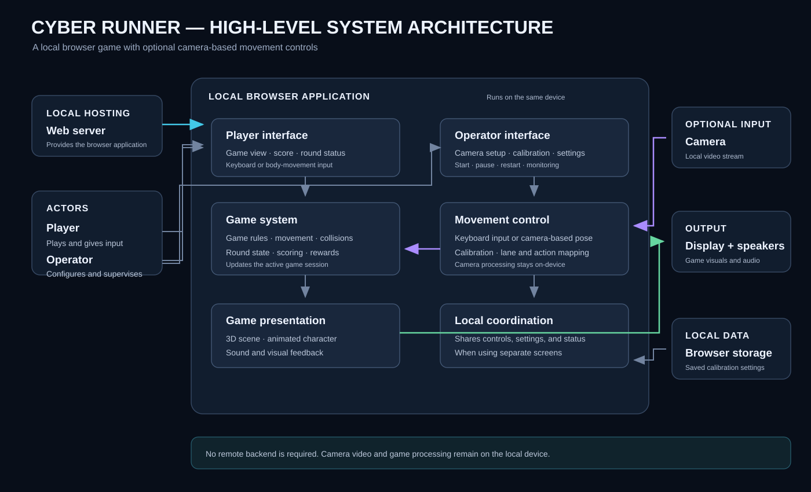

# Cyber Runner

An offline, camera-controlled 3D runner for interactive exhibitions. Stand in one of three physical lanes, jump over barriers, duck under gates and collect circuit coins. The player sees the game while an operator can manage the live camera and controls on a second monitor.

Created by **Rashmika Nishshanka**.

## Features

- Robotics Lab, AI Megacity and Data Core environments.
- A skinned human runner with animated running and procedural jump, crouch, landing and lane lean. The character is a separate local asset.
- Local pose tracking, smoothing, adjustable floor-lane guides and keyboard control.
- Separate player and operator windows with live settings and round controls.
- Circuit coins, rare extra-life cells, original synthesized music, interaction sounds and a 3–2–1 countdown.
- Fixed-step simulation, distance-synchronized gait and adaptive graphics.

## Requirements

- **Node.js 24** is the repository baseline. Check with `node --version`.
- A desktop browser with WebGL2; Chrome or Edge is recommended for exhibition use.
- A webcam and room to move, if using body control.
- The permitted local character described below.

There are **no npm package dependencies or build steps**. Three.js 0.180.0, MediaPipe Tasks Vision 0.10.21, its WASM runtime and the Full pose model are stored in `public/vendor/`. No API key or cloud account is needed to run the game.

## Quick start

Download or clone this repository and open a terminal in its folder.

**A fresh clone does not contain the Mixamo character.** First restore your permitted `public/assets/civilian-runner.glb` using [the asset setup instructions](docs/ASSET-SETUP.md). The existing exhibition folder already contains this file; it is kept local by `.gitignore`.

```sh
npm run assets:check
npm start
```

Open **http://127.0.0.1:5173/** and keep the terminal running. On Windows, you can also double-click **Start game.bat**. Stop the server with `Ctrl+C`.

Once the repository and local character are present, the game runs offline, including camera tracking. Use the server URL; opening `index.html` directly with `file://` will not provide the required browser environment.

## Play

| Input | Action |
| --- | --- |
| Left / right arrow or A / D | Change lane |
| Up arrow, W or Space | Jump |
| Down arrow or S | Duck |
| P | Pause / resume |
| Enter | Start when no round is running |

For body controls, enable the camera, keep the full body visible, align the guides with tape marking the **centres** of three lanes, and calibrate while upright. Select **Body movement**, then start. Calibrate each new player. Lane alignment is saved in the browser.

The camera drives game gestures; it is not full-body motion capture or a biomechanical simulation. Camera frames are processed on the device.

## Two monitors

1. Use **Extend** in Windows display settings (`Win+P`).
2. Select **Separate screens**. Allow the local popup if prompted.
3. Move the game window to the player display and select **Full screen**.
4. Keep **Controls & camera** visible on the operator display. Enable and calibrate the camera there; all settings and round controls are available.

Both layouts are designed for 1920×1080 without scrolling. Use the same browser profile and address for both windows. The operator window handles pose tracking and audio; only the player window renders 3D. Closing the controls or losing tracking pauses the game. **Single screen** restores the combined view.

See [the exhibition guide](docs/EXHIBITION.md) for calibration, graphics, performance, motion tuning and recovery details.

## Development

```sh
npm run check                 # Project JavaScript syntax checks
npm run assets:check:public   # Included offline files and checksums
npm test                     # Gameplay, tracking and window communication
npm run test:character       # Requires your local human character
```

GitHub Actions runs the public checks on Windows and Linux with Node.js 24. When the character is absent, its animation test reports an explicit skip; other tests still run. Use `test:character` to verify a complete local build. CI does not use a real camera or measure exhibition hardware performance.

After starting the server, visual checks are available at `/visual-check.html`, `/powerup-check.html` and `/worker-check.html`.

## Project map

| Path | Purpose |
| --- | --- |
| `public/index.html`, `public/game.js` | Combined view, player display and simulation |
| `public/controls.html`, `public/operator.js` | Operator controls and camera window |
| `public/game-screens.js`, `public/display-link.js` | Local window communication |
| `public/motion-controls.js`, `public/tracking.js`, `public/pose-worker.js` | Camera, calibration and tracking |
| `public/scene.js`, `public/lab.js`, `public/art.js` | Environments and materials |
| `public/character.js`, `public/motion.js`, `public/physics.js` | Animation and movement |
| `public/coins.js`, `public/energy-cell.js`, `public/powerups.js` | Collectibles |
| `public/audio.js`, `public/countdown.js` | Sound and countdown |
| `public/vendor/` | Pinned third-party runtime files |
| `server.mjs` | Local static server on port 5173 |
| `scripts/`, `*.test.mjs` | Repository checks and tests |



Read [the architecture overview](SYSTEM-ARCHITECTURE.md) and [contribution notes](CONTRIBUTING.md) before changing the project.

## Sharing and licensing

[GitHub upload instructions](docs/GITHUB.md) explain how to publish this repository. Backups, generated posters, archives, credentials and raw character files are excluded. Keep a separate private backup of the full exhibition folder, including the character.

No open-source license has been chosen for the original project; see [LICENSE.md](LICENSE.md). Third-party code and assets keep their own licenses, documented in [ASSET-CREDITS.md](ASSET-CREDITS.md). This custom runner does not include Subway Surfers code, artwork or soundtrack.
