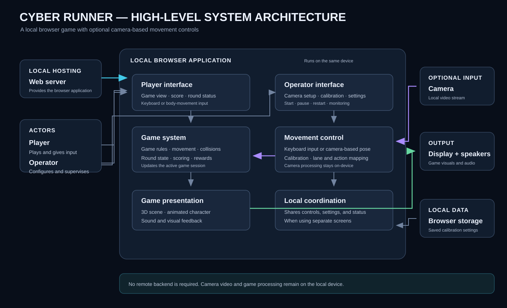

# Cyber Runner — High-Level System Architecture

Open [SYSTEM-ARCHITECTURE.svg](SYSTEM-ARCHITECTURE.svg) in a browser or image viewer to view the diagram.

The system consists of a player interface, an operator interface, and the game and movement-control capabilities within a local browser application. Keyboard input or optional camera-based movement controls drive the game. When the screens are separate, the interfaces exchange control and status information locally. The browser presents game visuals and audio and can retain calibration settings.

The system runs locally; camera video and game processing stay on the device, with no remote application backend required.
